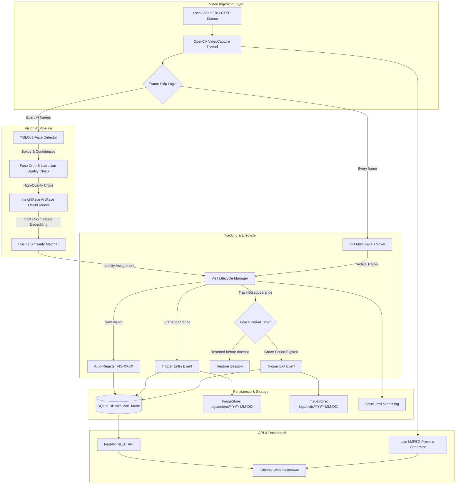

# VisiTrace System Architecture

## Overview

**VisiTrace** is an enterprise-grade visitor intelligence system providing real-time multi-face detection, continuous tracking, identity auto-registration, timestamped entry/exit event logging, and database-backed unique visitor counting.

The architecture strictly separates detection, feature extraction (embedding generation), multi-target tracking, stateful visit lifecycle management, and relational persistence.

## Core Modules

### 1. Ingestion Layer (`src/pipeline/stream_manager.py`)
- Independent background thread running `cv2.VideoCapture`.
- Supports both local video files (`.mp4`, `.avi`, `.mkv`) and RTSP streams.
- Reconnection logic for intermittent RTSP drops.
- Thread-safe latest frame buffer encoded to JPEG for the live preview MJPEG stream.
- Zero GUI blocking: start and stop requests happen asynchronously via REST API.

### 2. Detection & Recognition Pipeline (`src/models/`)
- **Face Detector (`detector.py`)**: Uses YOLOv8n-Face weights fine-tuned specifically for human faces. Outputs coordinates `[x1, y1, x2, y2]`, confidence scores, and extracts face crops.
- **Quality Filter**: Rejects crops below `min_face_size` (40px) or having a Laplacian variance below `min_face_quality` (35.0) to prevent registering motion-blurred transients.
- **Face Recognizer (`recognizer.py`)**: Official InsightFace MobileFaceNet ArcFace model executed through ONNX Runtime. Generates L2-normalized 512-dimensional embeddings. Computes cosine similarity against stored vectors.

### 3. Multi-Face Tracking & Visit Lifecycle (`src/tracking/`)
- **Tracker (`tracker.py`)**: IoU-based multi-face tracker with velocity prediction. Preserves track IDs across frames and handles brief occlusions.
- **Visit Manager (`visit_manager.py`)**: Enforces stateful visit lifecycles:
  - Associates track IDs with persistent visitor IDs (`VIS-XXXX`).
  - Idempotency: guarantees at most one entry and one exit event per visit session.
  - Grace Period: when a face leaves the camera FOV, a configurable grace timer (default 5.0s) prevents detector jitter or transient occlusions from triggering false exits.
  - Return visits: when an already registered person returns in a later session, creates a new visit (`VST-XXXX`) but keeps the unique visitor count unchanged.

### 4. Database & Transactional Persistence (`src/database/`)
- SQLite database configured with:
  - `PRAGMA journal_mode = WAL;` (Write-Ahead Logging for high-concurrency read/write)
  - `PRAGMA foreign_keys = ON;`
  - `PRAGMA busy_timeout = 5000;`
- **Tables**:
  - `visitors`: `visitor_id`, `first_seen_at`, `last_seen_at`, `embedding_blob`, `total_visits`, `quality_score`.
  - `visits`: `visit_id`, `visitor_id`, `source_id`, `entry_at`, `exit_at`, `status`, `duration_seconds`.
  - `events`: `event_id`, `visit_id`, `visitor_id`, `event_type`, `timestamp`, `image_path`, `track_id`.
  - **Constraint**: `CONSTRAINT uq_visit_event UNIQUE (visit_id, event_type)` ensures database-enforced idempotency.

### 5. Presentation Layer (`static/` & `src/api/`)
- Editorial visual identity: warm ivory background, deep graphite typography, muted forest-teal structure, controlled amber accents.
- Live canvas displaying real-time annotated video stream with bounding boxes, visitor tags, track IDs, and confidence overlays.
- Key KPIs: Unique Visitors, Active In-Scene, Total Entries, Total Exits, Today's Visitors.
- Interactive controls: start/stop stream, switch between local video and RTSP, load sample dataset, filter events, view registered visitor directories, inspect configurations and system health.
